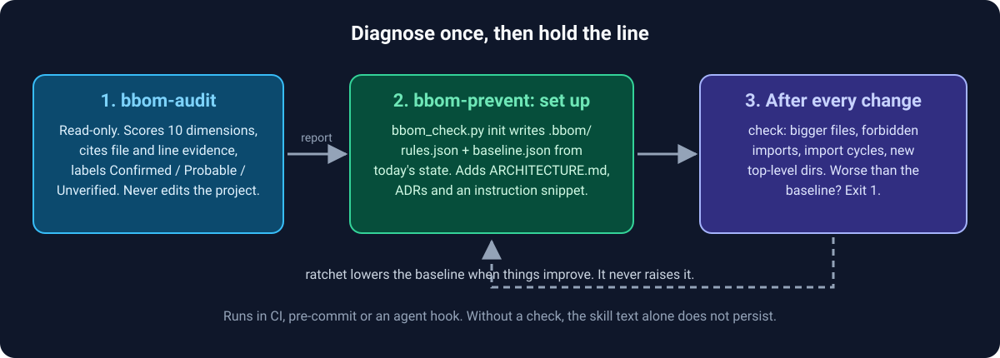

<p align="center">
  
</p>

> Portable [Agent Skills](https://agentskills.io) that tell you whether a codebase is a Big Ball of Mud, and stop it from becoming one.


Point an agent at a project and ask "is this a big ball of mud?". It reads the code, scores ten architecture dimensions, and writes a report that cites file and line evidence. Then turn on the prevention skill, and every later change is checked against the structure you have today.

> **Using an AI agent to install this?** Give it [`AGENTS.md`](AGENTS.md). It has the exact steps and the checks to run.

## Why

Architecture audits are one-off documents. They are right on the day and ignored a month later, while agents keep adding code that nobody places on purpose. Two problems follow:

- **Nobody knows where the project stands.** "It feels messy" is not a plan.
- **The mess keeps growing.** A rule that lives only in a document, or only in a skill's text, is not applied.

These skills split the work:

- **`bbom-audit` measures once.** Read-only. Every finding is labeled Confirmed, Probable or Unverified, and what could not be measured is listed, not guessed.
- **`bbom-prevent` holds the line.** It turns today's state into a baseline that can only move down, and a script that fails when a change makes the structure worse. The check runs in CI, pre-commit or an agent hook, so persistence comes from the project, not from the skill text.

<p align="center">
  
</p>

## The skills

| Skill | What it does | Writes to your project? |
|---|---|---|
| [`bbom-audit`](skills/bbom-audit) | Decides whether a codebase is a Big Ball of Mud. Scores ten dimensions, ranks risks with file-level evidence, proposes a staged recovery plan. | No. Only the report file you ask for. |
| [`bbom-prevent`](skills/bbom-prevent) | Sets up a `.bbom/` ratchet and checks every structural change against it: size ceiling, forbidden-import boundaries, import cycles, new top-level directories. | Yes, after you agree: `.bbom/`, `docs/ARCHITECTURE.md`, ADRs, an instructions snippet. |

Cycle detection covers Python and JS/TS. Other languages are reported as "not analysed", never as clean.

## Sample output

An excerpt from `bbom-audit` run on a deliberately messy 36-line Flask/SQLite fixture (`skills/bbom-audit/evals/audits-messy-toy-shop`). The full report has 14 sections and a summary for external review. It is written in the language you use.

> **Is it a big ball of mud? Not yet, and not systemically.** With four files and 36 lines, a person can hold the whole system in their head. It is better described as a **partially disorganized architecture in miniature**: no protected core, and it already shows the BBoM seeds (a circular dependency, one business rule copied three times with three different thresholds, persistence reached from every layer, swallowed errors, zero tests). Confidence in the classification: **medium**.
>
> - **Risk index:** 70.4 / 100, band **Elevated** (9 dimensions assessed; heuristic on an ordinal scale, not comparable across projects).
> - **Findings:** 9 total. Critical 1, high 5, medium 2, low 1. Labels: 8 Confirmed, 1 Probable, 0 Unverified.
> - **Not recommended:** a rewrite, microservices, or Clean Architecture/DDD scaffolding. For 36 lines that is cost without benefit.
>
> **ARQ-04 VIP discount: three divergent copies, can apply twice** (critical, Confirmed). `orders.py:7` discounts above 100, `billing.py:6` above 120, `app.py:9` above 80 (dead branch). `place_order` passes the already-discounted total to `charge`, which discounts again, so the stored order total and the debited amount disagree.

## Quick start

Requirements: `python3` (standard library only). `git` is optional.

1. Clone the repository and copy the skill folders into your project's skills directory. The folder name must stay equal to the skill name.

   ```sh
   git clone https://github.com/hassifernando/agent-skills.git
   mkdir -p your-project/.kiro/skills
   cp -R agent-skills/skills/bbom-audit   your-project/.kiro/skills/
   cp -R agent-skills/skills/bbom-prevent your-project/.kiro/skills/
   ```

   For Claude Code use `.claude/skills/` instead of `.kiro/skills/`.

2. Check the scripts run. Expected: a usage message and exit code 0.

   ```sh
   python3 your-project/.kiro/skills/bbom-audit/scripts/repo_stats.py --help
   python3 your-project/.kiro/skills/bbom-prevent/scripts/bbom_check.py --help
   ```

3. Ask your agent, from the project root:

   ```text
   Do an architecture audit of this project and tell me if it's a big ball of mud. Write the report to ./audit-report.md.
   ```

   The agent should name `bbom-audit`, read its `SKILL.md` first, run `repo_stats.py`, and write the report. Your project's files stay untouched.

4. To prevent regressions, ask: `Set up bbom-prevent for this project.` The agent explains what it will create and asks before writing. Review `.bbom/rules.json` with your team. Start any hook non-blocking (`|| true`).

### Where each harness looks for skills

| Harness | Project path | Status |
|---|---|---|
| Claude Code | `.claude/skills/<skill>/` (personal: `~/.claude/skills/`) | Evals run here (Claude Code), paths from its documentation |
| Kiro IDE | `.kiro/skills/<skill>/` (global: `~/.kiro/skills/`) | Paths from Kiro's documentation, not tested |
| Kiro CLI | `.kiro/skills/<skill>/` only. Global skills are IDE only. | `bbom-audit` tested end to end in `kiro-cli` 2.34.2 with a custom agent. `bbom-prevent` not tested |
| Cursor, GitHub Copilot, Gemini CLI, VS Code and others | see each tool's documentation | [Listed as supporting the format](https://agentskills.io/clients), untested here |

### Kiro CLI notes

- The default Kiro agent loads skills from `.kiro/skills/` by itself.
- A custom agent must list skills in `resources` **and must have a `tools` field**. In testing, an agent file with `allowedTools` but no `tools` made the model say "Let me read the skill" and stop without running anything. If your agent only narrates, check that field first.

  ```json
  {
    "name": "bbom-agent",
    "tools": ["*"],
    "allowedTools": ["@builtin"],
    "resources": ["file://.kiro/steering/**/*.md", "skill://.kiro/skills/*/SKILL.md"]
  }
  ```

  Save it as `.kiro/agents/bbom-agent.json` and run `kiro-cli chat --agent bbom-agent`.
- For `bbom-prevent`, copy `skills/bbom-prevent/assets/kiro-steering.md` to `.kiro/steering/architecture.md` so every session is told to use the skill. Workspace steering works in the CLI. Global steering does not.
- Kiro CLI 3.0 was announced for the end of October 2026 with changes to hooks. Re-check the hook example in [`wiring.md`](skills/bbom-prevent/references/wiring.md) after upgrading.
- Importing from GitHub in the Kiro IDE must point at a skill's subdirectory (for example `skills/bbom-audit`), not the repository root.

## Everyday use

Ask in plain language. Nothing to memorize:

- `Audit this repo's architecture and write the report to ./audit-report.md.`
- `Is this codebase a big ball of mud? Cite the evidence.`
- `Set up bbom-prevent here, and show me the boundary rules before you write them.`
- `I'm adding a payments module. Run the bbom-prevent before-you-change step first.`
- `Run the architecture check and tell me if my change made the structure worse.`

By hand, `/bbom-audit` and `/bbom-prevent` invoke the skills in harnesses that expose slash commands.

## Coming from another skill pack?

| Coming from... | What is similar | What these add |
|---|---|---|
| [addyosmani/agent-skills](https://github.com/addyosmani/agent-skills) | `constraint-driven-development` also ratchets numbers that must not get worse. `documentation-and-adrs` also covers ADRs. | A read-only architecture audit that scores a codebase and decides the Big Ball of Mud question. A baseline script that checks file size, forbidden imports, import cycles (Python, JS/TS) and new top-level directories. The two packs fit together, since the general lifecycle skills do not replace these. |

Compared on 2026-10-27, from that repository's published skill pages.

## What it does not do

- Cycles are detected for Python and JS/TS only. Boundaries are line-by-line regexes. Cohesion and semantic duplication are not measured by the script. They are the judgment step before a change.
- The audit is static: it does not run your code, read your database, or see production. It says so in the report.
- Without a check wired into CI, pre-commit or a hook, `bbom-prevent` relies on the agent following instructions.

## Repository layout

```text
AGENTS.md                    steps for an AI agent to install and use the skills
docs/                        images used by this README
skills/
  bbom-audit/
    SKILL.md                 workflow and ground rules
    references/              dimensions, BBoM signals, scoring, report template
    scripts/repo_stats.py    read-only metrics, stdlib only
    evals/                   test cases
  bbom-prevent/
    SKILL.md                 set up, before-you-change, after-you-change, drift report
    references/              guard checklist, rules schema, wiring (CI, pre-commit, hooks)
    assets/                  ARCHITECTURE.md, ADR template, agent snippet, Kiro steering
    scripts/                 bbom_check.py (init | check | ratchet | accept) and its tests
    evals/                   test cases
```

## Develop

```sh
cd skills/bbom-prevent
python3 -m unittest scripts/test_bbom_check.py
```

Validate a skill against the [Agent Skills specification](https://agentskills.io/specification) with the reference tool `skills-ref validate ./skills/<name>` (from [agentskills/agentskills](https://github.com/agentskills/agentskills/tree/main/skills-ref)).

## License

[MIT](LICENSE)
