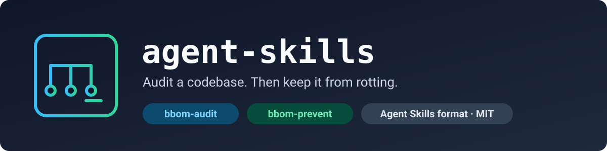

<p align="center">
  
</p>

> A collection of portable [Agent Skills](https://agentskills.io) for coding agents. Each skill is a self-contained folder you copy into a project.


Skills here follow the open `SKILL.md` format, so one folder works in any harness that reads it. Helper scripts use only the Python standard library, so there is nothing to install.

> **Using an AI agent to install these?** Give it [`AGENTS.md`](AGENTS.md). It has the exact steps and the checks to run.

## Skills

This table is generated from each skill's `SKILL.md` by `scripts/build_catalog.py`. Open a skill's folder for its README, with ready-to-paste prompts, usage, and instructions for agents.

<!-- skills:start -->
| Skill | Category | Version | What it does |
|---|---|---|---|
| [`bbom-audit`](skills/bbom-audit) | architecture | 0.1.0 | Read-only software architecture audit that decides whether a codebase is a Big Ball of Mud (BBoM) and how healthy its structure is. |
| [`bbom-prevent`](skills/bbom-prevent) | architecture | 0.1.1 | Keeps a codebase from degrading into a Big Ball of Mud, continuously, across sessions. |
<!-- skills:end -->

## Quick start

Requirements: `python3` (standard library only) for the skills' scripts. `git` is optional.

1. Clone the repository and copy the skill folders you want into your project's skills directory. Copy the whole folder, not only `SKILL.md`. The folder name must stay equal to the skill name.

   ```sh
   git clone https://github.com/hassifernando/agent-skills.git
   mkdir -p your-project/.claude/skills
   cp -R agent-skills/skills/<skill-name> your-project/.claude/skills/
   ```

   For Kiro use `.kiro/skills/` instead of `.claude/skills/`.

2. If the skill ships scripts, check they run. Expected: a usage message and exit code 0.

   ```sh
   python3 your-project/.claude/skills/<skill-name>/scripts/<script>.py --help
   ```

3. Ask your agent for the task the skill covers, in plain language. Each skill's README lists example prompts. The agent should name the skill and read its `SKILL.md` first.

### Or paste a prompt

Open your agent in the project root, check that `git status` is clean, and paste this. Replace `<skill-names>` with the skills you want (for example `bbom-audit`). Each skill's README has more prompts that install and run it in one go.

```text
Install these skills from https://github.com/hassifernando/agent-skills into this project: <skill-names>.

- Clone the repository into a temporary directory outside this project, then read AGENTS.md from that clone and follow it.
- Copy each skill folder, whole, into the skills directory of the harness I am using: .claude/skills/ for Claude Code, .kiro/skills/ for Kiro. If you are not sure which harness this is, ask me.
- Run the verification steps from AGENTS.md and show me the real output.
- Do not create any other file, do not run the skills, and do not commit anything.
```

Using Kiro CLI? Run it with an agent that has a `tools` field. See [Kiro CLI notes](#kiro-cli-notes).

### Where each harness looks for skills

| Harness | Project path | Status |
|---|---|---|
| Claude Code | `.claude/skills/<skill>/` (personal: `~/.claude/skills/`) | Evals run here (Claude Code), paths from its documentation |
| Kiro IDE | `.kiro/skills/<skill>/` (global: `~/.kiro/skills/`) | Paths from Kiro's documentation, not tested |
| Kiro CLI | `.kiro/skills/<skill>/` only. Global skills are IDE only. | `kiro-cli` 2.34.2 with a custom agent: `bbom-audit` and `bbom-prevent` setup (baseline, rules, steering) ran end to end on a real project. The hook file was written but not confirmed to fire |
| Cursor, GitHub Copilot, Gemini CLI, VS Code and others | see each tool's documentation | [Listed as supporting the format](https://agentskills.io/clients), untested here |

### Kiro CLI notes

- The default Kiro agent loads skills from `.kiro/skills/` by itself.
- A custom agent must list skills in `resources` **and must have a `tools` field**. In testing, an agent file with `allowedTools` but no `tools` made the model say "Let me read the skill" and stop without running anything. If your agent only narrates, check that field first.

  ```json
  {
    "name": "my-agent",
    "tools": ["*"],
    "allowedTools": ["@builtin"],
    "resources": ["file://.kiro/steering/**/*.md", "skill://.kiro/skills/*/SKILL.md"]
  }
  ```

  Save it as `.kiro/agents/my-agent.json` and run `kiro-cli chat --agent my-agent`.
- Workspace steering (`.kiro/steering/`) works in the CLI. Global steering does not.
- Kiro CLI 3.0 was announced for the end of October 2026 with changes to hooks. Re-check any hook example after upgrading.
- Importing from GitHub in the Kiro IDE must point at a skill's subdirectory (for example `skills/bbom-audit`), not the repository root.

## Repository layout

```text
AGENTS.md                      steps for an AI agent to install, verify and add skills
docs/                          images used by this README
scripts/build_catalog.py       regenerates the skills table and validates every skill
skills/
  <skill-name>/
    SKILL.md                   frontmatter plus the workflow the agent follows
    README.md                  usage, sample output, instructions for agents
    references/  scripts/  assets/  evals/  docs/     optional
```

## Add a skill

1. Create `skills/<name>/SKILL.md`. The folder name must equal `name`. Frontmatter needs `name`, `description` (1 to 1024 characters), `license`, and `metadata` with `category` and `version`.
2. Add a `README.md` in the skill folder. A diagram or sample output goes in that skill's own `docs/`, so the root never needs new images.
3. Run `python3 scripts/build_catalog.py`. It rewrites the table above and fails if a skill is invalid.
4. Run the checks below, commit, and tag the release as `<name>-v<version>`.

## Develop

```sh
python3 scripts/build_catalog.py --check                       # skills valid, README table current
cd scripts && python3 -m unittest test_build_catalog           # catalog script tests
cd ../skills/bbom-prevent && python3 -m unittest scripts/test_bbom_check.py
```

Validate a skill against the [Agent Skills specification](https://agentskills.io/specification) with the reference tool `skills-ref validate ./skills/<name>` (from [agentskills/agentskills](https://github.com/agentskills/agentskills/tree/main/skills-ref)).

## License

[MIT](LICENSE)
