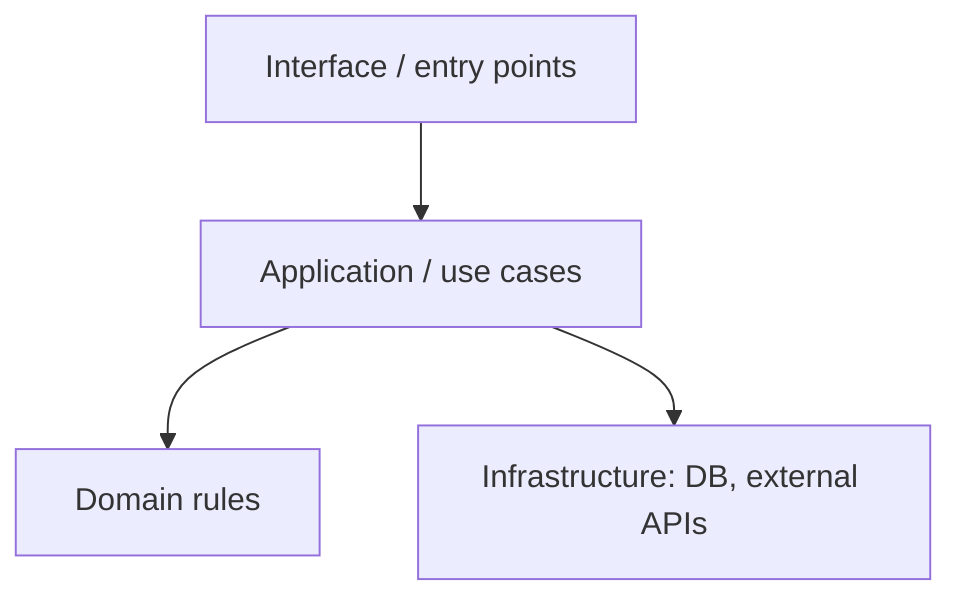

# Architecture

> Keep this short and true. If you change a module, a boundary or a contract, update it in the same change. Last updated: YYYY-MM-DD.

## Purpose
One paragraph: what the system does and for whom.

## Modules and ownership
| Module / directory | Responsibility (one sentence) | May depend on | Must not depend on |
|---|---|---|---|
| `src/...` | ... | ... | ... |

## Dependency direction

Arrows point from the dependent to the dependency. Nothing in a lower box imports a higher one. These are enforced in `.bbom/rules.json`.

## Rule owners
| Business rule | The one place that implements it |
|---|---|
| e.g. discount calculation | `src/domain/pricing.py` |

## Contracts
Where data crosses a boundary (APIs, queues, files, tables) and where its shape is defined.

## Known debt (grandfathered in `.bbom/baseline.json`)
- Large files and boundary violations that exist today, with the intended direction of repair.

## Decisions
Index of ADRs in `docs/adr/`.
